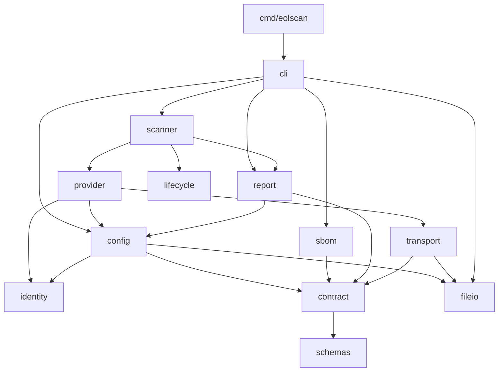

# Architecture

eolscan is a single-binary Go CLI. The entry point is `cmd/eolscan/main.go`; implementation packages are internal to the module.

## Package responsibilities

| Package | Responsibility |
| --- | --- |
| `cmd/eolscan` | Capture process signals, set up standard I/O and the HTTP client, and return the command's exit code. |
| `internal/cli` | Parse commands and flags; load policy, parse input, invoke the scanner, and write buffered output. |
| `internal/scanner` | Coordinate providers, evaluate each component, apply exceptions and CI conditions, and aggregate results. |
| `internal/sbom` | Parse supported SBOM formats with size, depth, and component limits. |
| `internal/identity` | Normalize exact PURLs and resolve release series. |
| `internal/lifecycle` | Evaluate evidence tiers, conflicts, support dates, notices, and signal aggregation without network or file access. |
| `internal/provider` | Convert catalog, deps.dev, and endoflife.date data into evidence and verification results. |
| `internal/transport` | Enforce HTTPS and allowed hosts; handle concurrency, retries, memoization, and optional disk caching. |
| `internal/config` | Load and validate policies, catalogs, reviews, and exceptions. |
| `internal/contract` | Validate embedded JSON schemas; decode YAML safely; produce canonical JSON and hashes. |
| `internal/model` | Define shared data contracts and small value helpers. |
| `internal/report` | Render tables, validate report invariants, and derive exit codes. |
| `internal/fileio` | Read bounded files and atomically replace cache or report files. |
| `internal/version` | Supply the application version. |
| `internal/testutil` | Supply fixed clocks, HTTP stubs, and fixture paths for tests. |

## Dependency direction



Application packages share types through `model`. The entry point owns process signals and exit; the CLI receives a context, I/O streams, HTTP client, and execution timestamp. Tests can inject these dependencies without changing global state.

Providers collect and normalize data. Lifecycle evaluation decides support status. The scanner combines results and applies CI policy. Provider errors remain evidence or diagnostics rather than silently becoming negative evaluations.

## Embedded assets

- `schemas/*.json` are the canonical schemas. The `schemas` package embeds them, and `contract` compiles them locally.
- `internal/config/defaults.yaml` contains the runtime defaults and is embedded by `config`.
- `examples/eol-policy.example.yaml` documents those defaults. A test checks that the example and embedded policy agree.
- Runtime execution requires no checkout, Python installation, or external schema files.

## Tests and fixtures

Package tests live beside their implementations. `tests/` covers the full scan pipeline and HTTP adapter interactions, including the 45 design acceptance cases.

`testdata/fixtures/manifest.json` uses repository-relative paths for inputs, policies, and expected reports. The fixture locator finds the module root without changing the working directory. File moves leave policy contents and raw SBOM bytes intact, preserving their report hashes.

`examples/` contains user-facing policies, catalogs, exceptions, a sample SBOM, and a sample report. Fictional acceptance cases are stored separately in `testdata/`.

## Development checks

```sh
make build
make test
make vet
make validate-design
```

GitHub Actions checks formatting, vet, race-enabled tests, binary compilation, and schema/fixture validation on pushes to main and pull requests. Tests use fixed API responses and a local HTTPS server; they require no live package API access.

## Extending the implementation

- Add source-specific response handling under `provider` and use `transport` for all external requests.
- Keep applicability, tier, conflict, and date decisions in `lifecycle`.
- Add formats under `sbom` and retain original component references.
- Update schemas, models, documentation, and acceptance fixtures together when changing a contract.
- Keep command flags and output handling in `cli`; the process entry point remains small.
