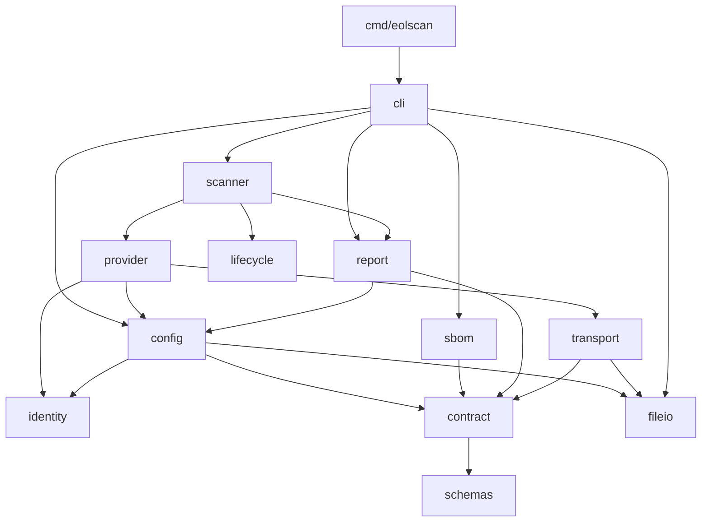

# Architecture

eolscan is a single-binary Go CLI. The entry point is `cmd/eolscan/main.go`; implementation packages are internal to the module.

## Package responsibilities

| Package | Responsibility |
| --- | --- |
| `cmd/eolscan` | Capture process signals, set up standard I/O and the HTTP client, and return the command's exit code. |
| `internal/cli` | Parse commands and flags; load policy, parse input, invoke the scanner, and write buffered output. |
| `internal/scanner` | Coordinate providers, evaluate each component, apply exceptions and CI conditions, and aggregate results. |
| `internal/sbom` | Parse supported SBOM formats with size, depth, and component limits. |
| `internal/identity` | Normalize exact PURLs and resolve release series. |
| `internal/lifecycle` | Evaluate evidence tiers, conflicts, support dates, notices, and signal aggregation without network or file access. |
| `internal/provider` | Convert catalogs, native registries, deps.dev, and endoflife.date data into evidence, version proofs, and signals; resolve metadata fallback. |
| `internal/transport` | Enforce HTTPS and allowed hosts; handle concurrency, host rate budgets, shared cooldowns, retries, memoization, and optional disk caching. |
| `internal/config` | Load and validate policies, catalogs, reviews, and exceptions. |
| `internal/contract` | Validate embedded JSON schemas; decode YAML safely; produce canonical JSON and hashes. |
| `internal/model` | Define shared data contracts and small value helpers. |
| `internal/report` | Render tables, validate report invariants, and derive exit codes. |
| `internal/fileio` | Read bounded files and atomically replace cache or report files. |
| `internal/version` | Supply the application version. |
| `internal/testutil` | Supply fixed clocks, HTTP stubs, and fixture paths for tests. |

## Dependency direction



Application packages share types through `model`. The entry point owns process signals and exit; the CLI receives a context, I/O streams, HTTP client, and execution timestamp. Tests can inject these dependencies without changing global state.

Providers collect and normalize data. Lifecycle evaluation decides support status. The scanner combines results and applies CI policy. Provider errors remain evidence or diagnostics rather than silently becoming negative evaluations.

The parser excludes only the metadata subject when configured to do so; nested components are independently filtered. Zero components in scope produce a validated failed report with `NO_COMPONENTS`. Scanner job dispatch and workers observe cancellation, and cancelled scans return no report. The CLI interrupts blocked stdin reads; the process entry point bounds shutdown even if file or output I/O is blocked. Interruptions exit 130.

### Lifecycle retrieval

The endoflife.date adapter loads an exact PURL index, then matched product details. Explicit security phase labels create curated security end claims at MEDIUM confidence. Unknown labels require a separate meaning review. Current online responses or usable cached snapshots supply dates; there is no fixed date catalog. Source labels, timestamps, and hashes remain in evidence. See [automatic lifecycle data](catalog.md).

### Metadata resolution

`provider.MetadataResolver` first uses a valid exact local version assertion. It requests native npm, PyPI, or RubyGems metadata when version verification or a requested native signal needs it, and uses deps.dev for unresolved supported checks. A verified native publication, including `NOT_RELEASED_AS_OF`, is not replaced by fallback data. If an already needed fallback response disagrees with native signal evidence, aggregation returns `UNKNOWN / SIGNAL_CONFLICT`.

The native registry loader shares an immutable parsed package snapshot across all SBOM versions and platforms of that package. It filters RubyGems publication proof by an explicit platform qualifier. Providers produce maintenance facts independently of lifecycle evidence. See [registry sources](registries.md) for the supported negative-evidence rules.

### Request scheduling

One shared transport owns a semaphore and token buckets keyed by hostname. It acquires a token after acquiring an HTTP slot, so requests cannot accumulate reservations and start in a burst when slots become free. Redirects and retries also consume tokens. HTTP 429/503 extends a shared host cooldown; an excessive wait returns a diagnostic instead of retrying early.

The run timestamp is fixed for evidence, cache age, and expiry. A separate live clock schedules rate limits and parses HTTP-date `Retry-After` values. Tests inject a clock, cancellable wait, and retry jitter. Memoization and disk keys distinguish the ordinary JSON representation from PyPI's vendor JSON media type.

## Embedded assets

- `schemas/*.json` are the canonical schemas. The `schemas` package embeds them, and `contract` compiles them locally.
- `internal/config/defaults.yaml` contains the runtime defaults and is embedded by `config`.
- Product lifecycle dates are retrieved by the endoflife.date adapter. Optional local official catalogs are loaded from files; their review expiry is checked against execution time and their contents participate in the policy hash.
- `examples/eol-policy.example.yaml` documents those defaults. A test checks that the example and embedded policy agree.
- Runtime execution requires no checkout, Python installation, or external schema files.

## Tests and fixtures

Package tests live beside their implementations. `tests/` covers the full scan pipeline and HTTP adapter interactions, including the 45 design acceptance cases.

`testdata/fixtures/manifest.json` uses repository-relative paths for inputs, policies, and expected reports. The fixture locator finds the module root without changing the working directory. Report policy hashes are updated when effective defaults or referenced catalog contents change; raw SBOM hashes remain tied to the original bytes.

`examples/` contains user-facing policies, catalogs, exceptions, a sample SBOM, and a sample report. Fictional acceptance cases are stored separately in `testdata/`.

## Development checks

```sh
make build
make test
make vet
make validate-design
```

GitHub Actions checks formatting, vet, race-enabled tests, binary compilation, and schema/fixture validation on pushes to main and pull requests. Tests use fixed API responses and a local HTTPS server; they require no live package API access.

## Extending the implementation

- Add source-specific response handling under `provider` and use `transport` for all external requests.
- Register native signal capabilities in the metadata resolver and keep insufficient data `UNKNOWN`; a CI-required unresolved check must mark the scan incomplete.
- Keep applicability, tier, conflict, and date decisions in `lifecycle`.
- Add formats under `sbom` and retain original component references.
- Update schemas, models, documentation, and acceptance fixtures together when changing a contract.
- Keep command flags and output handling in `cli`; the process entry point remains small.
